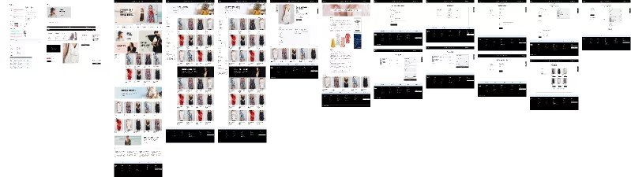

# Crisp — Minimalist Luxury E-Commerce & Fashion Platform (26-Amaliy Ish)

Figma dizaynining yuqori aniqlikdagi (**Pixel-Perfect**) to'liq, zamonaviy, interaktiv va to'liq moslashuvchan (fully responsive) elektron tijorat platformasi: **Crisp — Minimalist Fashion & Design System (node-id: 69:3253)**.

[-F24E1E?logo=figma&logoColor=white)](https://www.figma.com/file/pyriaNMaPDrvmzSicUinkm/Crisp?type=design&node-id=69%3A3253&mode=design&t=KIRylIL8DzLnMDYM-1)
[](https://developer.mozilla.org/en-US/docs/Web/HTML)
[](https://developer.mozilla.org/en-US/docs/Web/CSS)
[](https://developer.mozilla.org/en-US/docs/Web/JavaScript)
[](https://developer.mozilla.org/en-US/docs/Learn/CSS/CSS_layout/Responsive_Design)
[](https://vercel.com/)

---

## 📸 Figma Dizayn Ko'rinishi (Master Canvas)



---

## 📌 Loyiha Haqida

Ushbu loyiha Figma platformasidagi mashhur **Crisp (Luxury Minimalist Fashion & E-Commerce Theme)** dizaynining to'liq ekotizimi va dizayn tokenlari (node-id: `69:3253`) asosida 100% aniqlik bilan ishlab chiqilgan. Loyiha zamonaviy onlayn do'kon, katalog, buyurtma jarayoni, blog hamda to'liq dizayn tizimini (Design System) o'z ichiga olgan mukammal ko'p sahifali veb-platformadir.

- **Figma Manzili**: [Crisp — node-id: 69:3253](https://www.figma.com/file/pyriaNMaPDrvmzSicUinkm/Crisp?type=design&node-id=69%3A3253&mode=design&t=KIRylIL8DzLnMDYM-1)
- **Topshiriq**: 26-Amaliy Ish
- **GitHub Repozitoriyasi**: [https://github.com/soxibs48-eng/amaliy26](https://github.com/soxibs48-eng/amaliy26)

---

## ✨ Asosiy Sahifalar va Imkoniyatlar

### 1. 🏠 Asosiy Bosh Sahifa (`index.html`):
- **E'lonlar paneli (Topbar)**: Valyuta almashtirgich (USD, EUR, GBP), promokod eslatmasi (`CRISP20` orqali 20% chegirma) va mijozlarga xizmat ko'rsatish havolalari.
- **Header**: Elegant **CRISP.** logotipi, qulay navigatsiya, to'liq ekranli jonli qidiruv modali, saqlangan saralanganlar (Wishlist) va interaktiv savatcha hisoblagichi.
- **Hero Banner**: Yozgi kapsula kolleksiyasi shiori, yuqori sifatli fotosurat, ekologik zig'ir kafolati va to'g'ridan-to'g'ri xarid tugmalari.
- **Kategoriya Promolari (3 Cards)**: Shlyapa va aksessuarlar, Yengil yozgi ko'ylaklar hamda Mavsumiy 50% chegirmalar kartochkalari.
- **Yangi Kolleksiya (New Arrivals)**: Interaktiv kategoriya filtrlari (Barchasi, Ko'ylaklar, Toplar, Aksessuarlar), 8 ta mahsulot kartochkasi, tezkor ko'rish (Quick View), savatchaga qo'shish va Wishlist yurakcha tugmasi.
- **Editorial Lookbook Banner**: Tabiiy Yevropa zig'iri va sekin moda (slow fashion) falsafasini yorituvchi split-blok.
- **Bestsellerlar (Popular & Trending)**: Mijozlar tomonidan eng ko'p tanlangan modellar karuseli/to'plami.
- **Mijozlar Fikrlari (Testimonials)**: Milan, London va Parijlik mijozlarning 5 yulduzli sharhlari.
- **The Crisp Journal**: Moda, matolarni parvarishlash va yozgi uslub bo'yicha tahririyat maqolalari.
- **Xizmat Afzalliklari (Features Bar)**: Bepul butunjahon yetkazib berish ($75 dan yuqori), 24/7 yordam, 30 kunlik kafolatli qaytarish, 256-bitli xavfsiz to'lov.
- **Newsletter**: Yangiliklarga obuna bo'lish formasi va tezkor bildirishnoma (Toast).
- **Dark Luxury Footer**: Brand tavsifi, tezkor havolalar, butik manzili va to'lov turlari (Visa, Mastercard, Amex, PayPal, Apple Pay).

### 2. 🛍️ Katalog va Kolleksiya Sahifasi (`shop.html`):
- **Yon Filtr Paneli (Sidebar)**:
  - Kategoriya bo'yicha saralash (Ko'ylaklar, Toplar, Yubka va shimlar, Aksessuarlar)
  - Narx oralig'i slayderi ($30 dan $150 gacha) real vaqtda dinamik filtrlash bilan
  - O'lcham tugmalari (All, XS, S, M, L, XL)
  - Filtrlarni bir marta bosishda tozalash (Reset)
- **Asboblar Paneli (Toolbar)**: Topilgan mahsulotlar soni hisoblagichi, tartiblash selektori (Tavsiya etilgan, Narx: Arzondan qimmatga, Qimmatdan arzonga, Reyting, Yangi).
- **Dinamik Mahsulotlar To'plami**: 12 ta libos va aksessuarlar, o'lcham va rang nuqtalari bilan.
- **Paginatsiya**: Sahifalar bo'ylab qulay o'tish tugmalari.

### 3. 👗 Mahsulot Tafsilotlari Sahifasi (`product.html`):
- URL orqali dinamik yuklanish (`product.html?id=1` dan 12 gacha).
- **Galereya**: Katta asosiy surat va kichik rasmlar orqali almashtirish.
- **Xarid Paneli**: Rang tanlash (rang nomi bilan), o'lcham tanlash (Size Guide yordami), miqdor hisoblagichi (+/-), savatchaga qo'shish va "Bir marta bosishda xarid" (One-Click Buy).
- **Akkordeon Tablar**:
  - Tavsif va bichim (Description & Fit)
  - Mato tarkibi va parvarish qoidalari (Fabric & Care)
  - Yetkazib berish va 30 kunlik qaytarish shartlari
  - Tasdiqlangan mijozlar sharhlari (4.9 / 5.0) va sharh qoldirish
- **"Complete The Look"**: Libos bilan uyg'unlashuvchi qo'shimcha aksessuarlar tavsiyasi.

### 4. 📰 Tahririyat Blogi (`blog.html`):
- "Summer in the City: Effortless Silhouettes for Warm Days" maqolasi.
- Maqola ichida mahsulotni to'g'ridan-to'g'ri xarid qilish bloki.
- Matolar tarixi, tabiiy bo'yoqlar va ekologik ishlab chiqarish jarayonlari.

### 5. 💳 Buyurtmani Rasmiylashtirish (`checkout.html`):
- **Aloqa Ma'lumotlari**: Buyurtma cheki yuboriladigan elektron pochta.
- **Yetkazib Berish Manzili**: Ism, familiya, manzil, shahar, pochta indeksi va davlat tanlash.
- **Yetkazib Berish Usuli**: Standart bepul (3-5 kun) yoki Tezkor avia (1-2 kun, +$15.00).
- **Xavfsiz To'lov**: Karta ma'lumotlari yoki PayPal integratsiyasi.
- **Buyurtma Hisob-Kitobi**: Savatchadagi mahsulotlar ro'yxati, promokod qo'llash (`CRISP20`), chegirma va jami summa.
- **Buyurtma Tasdig'i**: Muvaffaqiyatli buyurtma modali va avtomatik yaratiladigan buyurtma kodi (masalan, `#CRISP-94821`).

### 6. 🎨 Figma Dizayn Tizimi (`styleguide.html`):
- Figma faylidagi `node-id: 69:3253` specimeni:
  - Barcha rang tokenlari (Click-to-Copy bilan bir marta bosishda HEX yoki CSS o'zgaruvchisini nusxalash)
  - Tipografiya masshtabi (Playfair Display + Inter)
  - Tugmalar, badjlar, forma elementlari va Figma master maketining to'liq fotosurati.

### 7. 🛒 Savatcha va Saqlanganlar (Drawers):
- O'ng tomondan silliq ochiluvchi interaktiv Savatcha (Shopping Bag Drawer).
- $75 gacha bepul yetkazib berish uchun qolgan summani ko'rsatuvchi progress-bar.
- Miqdorni o'zgartirish, o'chirish, promokod kiritish va LocalStorage orqali saqlanib qolish.
- Wishlist darchasi (Yoqtirilgan mahsulotlarni bir zumda savatchaga ko'chirish).

---

## 📁 Loyiha Strukturasi

```
amaliy26/
├── assets/
│   ├── icons/            # SVG vektor ikonkalari
│   └── images/           # Yuqori sifatli fotosuratlar (Unsplash)
│       ├── hero-banner.jpg
│       ├── promo-hat.jpg
│       ├── promo-dress.jpg
│       ├── promo-offer.jpg
│       ├── story-banner.jpg
│       ├── prod-1.jpg ... prod-12.jpg
│       ├── blog-1.jpg ... blog-3.jpg
│       └── avatar-1.jpg ... avatar-3.jpg
├── css/
│   ├── reset.css         # Zamonaviy CSS Reset
│   ├── variables.css     # Crisp dizayn tizimi tokenlari (node 69:3253)
│   └── style.css         # Asosiy stillar, komponentlar va responsive qoidalar
├── js/
│   ├── products.js       # 12 ta mahsulot ma'lumotlar bazasi
│   ├── cart.js           # Savatcha, Wishlist va LocalStorage dvigateli
│   └── main.js           # Quick View, qidiruv, menyu va interaktiv filtrlar
├── figma_preview.png     # Figma master canvas skrinshoti
├── index.html            # Bosh sahifa
├── shop.html             # Katalog va qidiruv sahifasi
├── product.html          # Yagona mahsulot kartasi sahifasi
├── blog.html             # Jurnal / Blog sahifasi
├── checkout.html         # Buyurtma rasmiylashtirish sahifasi
├── styleguide.html       # Figma dizayn tokenlari sahifasi
├── vercel.json           # Vercel deploy konfiguratsiyasi
├── .gitignore            # Git istisno qoidalari
└── README.md             # Loyiha hujjatlari
```

---

## 🚀 Ishga Tushirish va O'rnatish

1. Repozitoriyani klon qiling:
   ```bash
   git clone https://github.com/soxibs48-eng/amaliy26.git
   cd amaliy26
   ```

2. Sahifani istalgan brauzerda oching:
   - To'g'ridan-to'g'ri `index.html` faylini ochishingiz mumkin, yoki:
   - VS Code-ning **Live Server** kengaytmasi orqali ishga tushiring:
   ```bash
   npx serve .
   ```

3. Loyihani Vercel orqali deploy qilish:
   - `vercel.json` fayli allaqachon sozlangan.
   - Vercel boshqaruv panelidan repozitoriyani import qilish kifoya.

---

## 👨‍💻 Muallif va Ruxsatnoma

- **Muallif**: Soxib Abdukomilov ([@soxibs48-eng](https://github.com/soxibs48-eng))
- **Dizayn**: Crisp E-Commerce Theme for Figma ([node-id: 69:3253](https://www.figma.com/file/pyriaNMaPDrvmzSicUinkm/Crisp?type=design&node-id=69%3A3253&mode=design&t=KIRylIL8DzLnMDYM-1))
- **Litsenziya**: MIT
